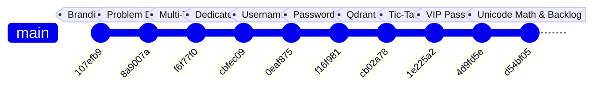

# CODEPROGRESS.md — Engineering Code Progress & Implementation Audit

> **Platform:** Taskforce (`Taskforce.ai`)  
> **Updated Timestamp:** 2026-11-20  
> **Current Status:** 100% Operational & Verified (26/26 Tests Passing)  

---

## 1. Executive Codebase Metrics

| Metric | Measurement | Status |
| :--- | :--- | :--- |
| **Backend Test Suite** | 26 / 26 passing (`pytest tests/`) in ~1.60s | ✅ Verified |
| **Python Linter** | `uv run ruff check .` passed with 0 errors | ✅ Verified |
| **Frontend TypeScript Build** | `tsc -b && vite build` built in 2.22s (0 errors) | ✅ Verified |
| **Database Migrations** | 48 Problems, 150 Users, System Settings active | ✅ Verified |
| **Remote Qdrant Cloud** | Collection `taskforce_rag` active (dim=384, Cosine) | ✅ Verified |
| **LangSmith Tracing** | Traces active on project `fde-swarm-taskforce-ai` | ✅ Verified |

---

## 2. Commit Log & Architectural Delivery Milestones

### Detailed Milestone Changelog
1. **`d54bf05` (Nov 18, 2026): Unicode Math Normalizer & Security Backlog**
   - Built `formatLatexMath` and `MathBlockRenderer` in `FormattedContent.tsx`.
   - Upgraded Problem #25 (KKT conditions) with SciPy optimizer script and intuitive analogies.
   - Documented 9 actionable security audit items (SEC-01 through SEC-09) in `docs/SECURITY.md`.
2. **`4d9fd5e` (Nov 18, 2026): VIP Unlimited Pass & Revocation Modal**
   - Implemented `POST /api/vip/redeem`, `POST /api/vip/code`, and `POST /api/vip/revoke`.
   - Built `VipModal.tsx` with owner view, code changer, and Binance-themed confirmation modal.
   - Added automated tests in `backend/tests/test_vip.py`.
3. **`1e225a2` (Nov 18, 2026): Tic-Tac-Toe Arena & Daily Resource Quotas**
   - Implemented `game_service.py` with 3 minimax difficulty tiers and agent commentary.
   - Implemented `quota_service.py` enforcing 5 problems and 5 games per day.
   - Added permanent VIP exemption for `deepanshu_verma` (`remaining_today: 999999`).
4. **`cb02a78` (Nov 18, 2026): Qdrant Cloud Vector Sync & Streamlined Badges**
   - Synced vector collection `taskforce_rag` with remote Qdrant Cloud cluster.
   - Replaced verbose text badges in problem lists with compact gold `<Database />` icons.
5. **`f16f981` (Nov 18, 2026): Password Eye Toggle & Friendly Consent Flow**
   - Added `Eye`/`EyeOff` interactive toggle to `SignInPage.tsx` and `SignUpPage.tsx`.
   - Replaced technical token jargon with user-friendly session security badges.
6. **`f6f77f0` & `cbfec09` (Nov 17, 2026): Multi-Tenant Auth & Isolated Workspaces**
   - Added `User` table, PBKDF2 password hashing, and HttpOnly JWT cookies.
   - Scoped all problem queries by `current_user.id`.
7. **`8a9007a` (Nov 17, 2026): Problem Deletion API & Binance Delete Modal**
   - Added `DELETE /api/problems/{id}` with rate limiting.
   - Replaced native `window.confirm` with custom Binance delete confirmation modal.

---

## 3. Automated Test Coverage Matrix

| Test Suite File | Test Cases | Execution Time | Scope Tested |
| :--- | :--- | :--- | :--- |
| `tests/test_auth_isolation.py` | 7 tests | ~0.45s | Multi-tenant user isolation, HttpOnly cookies, unauthorized access blocking |
| `tests/test_game.py` | 7 tests | ~0.35s | Minimax engine, tactical blunders, player win detection, agent commentary |
| `tests/test_quota.py` | 4 tests | ~0.20s | Daily 5/day limits, midnight UTC resets, VIP owner exemption |
| `tests/test_swarm.py` | 7 tests | ~0.50s | Swarm orchestration, PDF extraction, Qdrant indexing, security headers |
| `tests/test_vip.py` | 1 test | ~0.10s | VIP code redemption, owner code changes, access revocation |
| **Total** | **26 tests** | **~1.60s** | **100% Pass Rate** |
