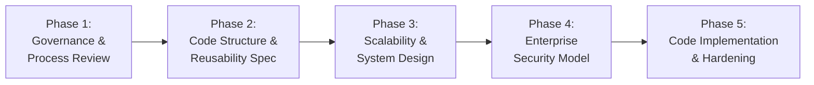

# Strategic Implementation Plan: Enterprise Swarm Platform

> **Status:** Pending User Approval  
> **Author:** Antigravity (Forward Deployed Engineering AI Assistant)  
> **Scope:** Architecture Documentation, Scalability Design, Enterprise Security, and Governance

---

## 1. Executive Summary

The objective of this initiative is to elevate the **SwarmLead FDE** platform into a resilient, production-hardened multi-agent system capable of scaling to millions of users while maintaining rigid code standards, zero security vulnerabilities, and deterministic multi-agent orchestration.

To guarantee that future agents and developers operate with 100% consistency, the platform requires an authoritative governance system where every agent reads `AGENTS.md` and the `/docs/` guides before taking any action.

---

## 2. Phased Roadmap

### Phase 1: Agent Governance & Protocols (Current Step)
- [x] Author `docs/PROCESS.md`: 7-Stage agent engineering lifecycle, Tech Lead supervision, and DoD.
- [x] Author `docs/PLAN.md`: Strategic roadmap, phase breakdown, and verification milestones.
- [ ] **USER REVIEW & APPROVAL GATE**: Review `docs/PROCESS.md` and `docs/PLAN.md` with the user.
- [ ] Author `AGENTS.md`: The single source of truth for agent behavior, entrypoint reading sequence, role boundaries, and output formats.

### Phase 2: Codebase Structure & Reusability Specification (`docs/STRUCTURE.md`)
- Define strict folder and file organization for `backend/` and `frontend/`.
- **Backend Standards:**
  - Service-Repository Layered Pattern: API Route $\rightarrow$ Service $\rightarrow$ Graph/Agent $\rightarrow$ DB Repository.
  - Type-safe Pydantic v2 schemas for all inputs/outputs.
  - Modular LangGraph state machine contracts.
- **Frontend Standards:**
  - Atomic component hierarchy (`components/`, `hooks/`, `services/`, `types/`).
  - Strict TypeScript types (zero `any`).
  - Unified Tailwind design tokens for consistent UI styling across all views.
  - Reusable component primitives (Buttons, Modals, Badges, Code Viewers, Ticker ribbons).

### Phase 3: High-Scale System Architecture (`docs/SYSTEM_DESIGN.md`)
- Blueprint to scale the application to **millions of concurrent users**:
  - **Distributed Task & Agent Execution:** Transition from in-process tasks to distributed worker pools (Redis / Celery / Temporal) with priority queues for heavy swarm runs.
  - **Database Scalability:** SQLite (current development/single-node) $\rightarrow$ PostgreSQL with read replicas, PgBouncer connection pooling, and problem sharding/partitioning.
  - **Real-Time Streaming at Scale:** Distributed WebSockets / Server-Sent Events via Redis Pub/Sub cluster.
  - **Caching & CDN:** Redis caching for problem metadata, rate limits, and dashboard statistics; Cloudflare CDN for frontend assets.
  - **Multi-Tenant Isolation & Quota Management:** Per-user/tenant workspace isolation, token limits, and spend caps.

### Phase 4: Enterprise Security Model (`docs/SECURITY.md`)
- Comprehensive security hardening specification:
  - **Security Headers (Helmet for FastAPI):** Strict Content-Security-Policy (CSP), HTTP Strict Transport Security (HSTS), X-Content-Type-Options, X-Frame-Options (`DENY`), and Referrer-Policy.
  - **Authentication & Session Security:** HTTP-Only, Secure, SameSite=Strict cookies with JWT / session token rotation.
  - **Rate Limiting:** Granular IP-based and user-based token bucket rate limiting on `/api/problems`, `/api/solve`, and SSE endpoints.
  - **Input Validation & Sanitization:** Pydantic strict parsing, HTML sanitization, SQL injection prevention via parameterized ORM queries.
  - **LLM-Specific Security:** Prompt injection defenses, output sanitization before rendering in DOM, and secret/PII redaction.
  - **CORS Hardening:** Strict origin whitelisting in production environments.

### Phase 5: Implementation & Code Hardening
- Implement security headers and rate limiter middleware in FastAPI.
- Refactor backend and frontend code to conform strictly to `docs/STRUCTURE.md`.
- Validate with end-to-end verification, automated tests, and LangSmith observability traces.

---

## 3. Immediate Next Steps & Review Checkpoint

1. **User Review:** Review this plan (`docs/PLAN.md`) and the operational process (`docs/PROCESS.md`).
2. **Approval:** Upon user confirmation, proceed to implement:
   - `AGENTS.md` (Root operating charter)
   - `docs/STRUCTURE.md` (Codebase structure & reusable patterns)
   - `docs/SYSTEM_DESIGN.md` (Scalability to millions of users)
   - `docs/SECURITY.md` (Enterprise security model)
   - Code middleware implementation (Security headers, cookies, rate limiting)
