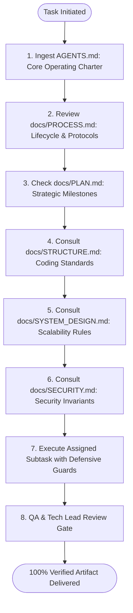

# Engineering & Agent Execution Process

> **Status:** Draft / Pending Review  
> **Target Audience:** All AI Agents & Software Engineers working on SwarmLead FDE  
> **Mandatory Rule:** Every agent executing a task MUST read `AGENTS.md` first, followed by this document and the relevant documents in `/docs/`.

---

## 1. Operating Charter & Guiding Principles

SwarmLead FDE is an enterprise-grade Autonomous Multi-Agent Problem Resolution Platform designed to showcase senior Forward Deployed Engineering (FDE) practices. 

Every AI agent operating in this repository must adhere to the following principles:
1. **Deterministic Quality & Verification**: No code is delivered without automated test verification, defensive type checking, and boundary validation.
2. **Hierarchical Supervision**: The Tech Lead Orchestrator has complete global visibility and ultimate authority over code standards, architecture, and task routing.
3. **Self-Healing Critique Loop**: When an agent produces an incomplete, vulnerable, or buggy artifact, the Tech Lead rejects it, issues explicit corrective instructions, and enforces a revision cycle.
4. **Observable by Design**: Every agent interaction, token cost, latency metric, and decision rationale is traced in SQLite and LangSmith.

---

## 2. Agent Execution Hierarchy & Protocol

Every agent invocation follows an immutable sequence:

---

## 3. The 7-Stage Problem Resolution Lifecycle

### Stage 1: Ingestion & Problem Dossier Formulation
- Ingest user issue: title, detailed narrative, failing code snippet, error logs/stack traces, target language, and user-specified swarm worker count (1–5 agents).
- Normalize input into a standardized `ProblemState`.

### Stage 2: Tech Lead Decomposition & Task Dispatch
- **Agent:** `TechLead-Orchestrator`
- Analyzes root mechanics of the issue.
- Formulates a task breakdown suited for the selected swarm capacity:
  - **1 Agent:** Generalist Senior Full-Stack Engineer.
  - **2 Agents:** Root Cause Analyst + Patch Engineer.
  - **3 Agents:** + QA & Boundary Validator.
  - **4 Agents:** + Security & Performance Auditor.
  - **5 Agents:** + Integration & Systems Architect.
- Issues explicit scope boundaries and prompt directives for each worker.

### Stage 3: Swarm Execution (Concurrent Worker Phase)
- Assigned worker agents execute their specialized analytical tasks in parallel:
  - Isolating failure lines and state corruption.
  - Generating candidate patch diffs with minimal blast radius.
  - Generating unit tests and edge-case assertions.
  - Auditing algorithmic time/space complexity and CVE vulnerabilities.
- Each agent tracks prompt tokens, completion tokens, execution cost, and step latency.

### Stage 4: QA & Edge-Case Boundary Verification
- Candidate patch is subjected to simulated/actual runtime verification:
  - Boundary assertions (null, empty payloads, malformed inputs).
  - Regression testing against initial error trace.
  - Type checking and syntax tree verification.

### Stage 5: Tech Lead Code Review & Intervention Loop
- **Supervisor Checkpoint:** The Tech Lead audits all worker deliverables.
- **Evaluation Criteria:**
  - Did the patch solve the root issue identified by the analyst?
  - Does the patch introduce new exceptions, breaking API signatures, or security risks?
  - Are tests green and defensive guards active?
- **Branching Decision:**
  - **If Flaws / Missed Edge Cases Detected:** Tech Lead triggers `CRITIQUE` event, issues detailed corrective instructions to the target worker (e.g. `Worker-PatchEngineer`), and loops back for re-implementation.
  - **If 100% Validated:** Tech Lead generates `VERIFICATION` event and proceeds to final synthesis.

### Stage 6: Final Solution Synthesis & LangSmith Observability
- Tech Lead compiles the unified resolution dossier:
  - Architectural diagnosis.
  - 100% verified production-ready code patch.
  - QA verification suite & passing assertions.
  - LangSmith evaluation scores (Correctness, Confidence, Edge Case Coverage, Security).
- Cost, latency, and full token telemetry logged to SQLite and streamed to frontend.

### Stage 7: Client Presentation & Artifact Archiving
- Problem updated to `RESOLVED`.
- Frontend dashboard updates in real-time via SSE/WebSockets.
- Patch diff ready for one-click copy and deployment.

---

## 4. Definition of Done (DoD)

A task or resolution is only considered **DONE** when:
1. The code adheres to all architectural patterns in `docs/STRUCTURE.md`.
2. All security requirements in `docs/SECURITY.md` (headers, rate limiting, sanitization, defensive typing) are verified.
3. No hallucinated imports, deprecated APIs, or syntax anomalies exist.
4. Token usage and latency have been calculated and logged to SQLite and LangSmith.
5. The Tech Lead has explicitly signed off with a quality score $\ge 95\%$.
