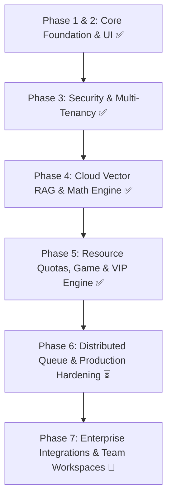

# ROADMAP.md — Strategic Product & Engineering Roadmap

> **Platform:** Taskforce (`Taskforce.ai`)  
> **Target Audience:** Product Managers, Engineering Leads, Platform Architects  
> **Status:** Active & Current  

---

## 1. Product Horizon Overview

Taskforce has transitioned from an experimental multi-agent testbed into a production-hardened autonomous problem resolution platform. Below is the multi-quarter roadmap detailing completed phases, active releases, and planned horizons.

---

## 2. Completed Milestones (v1.0 – v2.4)

| Milestone | Version | Core Deliverables | Impact |
| :--- | :--- | :--- | :--- |
| **Foundation** | v1.0.0 | LangGraph swarm engine, 6 specialized agents, Tech Lead self-healing critique loop | Autonomous problem diagnosis and multi-agent synthesis |
| **Experience** | v1.5.0 | Tactical Binance theme, VS Code code blocks, prompt compression under 8k Groq TPM | Main-thread responsiveness, low token cost |
| **Security** | v2.0.0 | HttpOnly cookie auth, tenant isolation, sliding-window rate limiters, password eye toggle | Secure multi-user access with zero cross-tenant leaks |
| **Intelligence**| v2.2.0 | Qdrant Cloud vector RAG, document parsing, Unicode LaTeX math normalizer | Deep context retrieval from uploaded PDFs; readable math |
| **Engagement** | v2.4.0 | Tic-Tac-Toe Arena (`/game`), 5/day quotas, VIP Unlimited access pass, Owner admin console | Abuse protection, user delight, dynamic owner monetization |

---

## 3. Near-Term Roadmap (Phase 6: Current Horizon)

### Gate 1: Security Hardening & Zero-Trust Middleware
- **Scope:** Complete the security audit backlog items documented in `docs/SECURITY.md`.
- **Items:**
  - `SEC-01`: Trusted reverse-proxy header validation (`X-Forwarded-For`) to prevent IP spoofing in rate limits.
  - `SEC-02`: Server startup assertion requiring non-default `SECRET_KEY` in production environments.
  - `SEC-04`: Mandatory authentication check on `POST /api/upload-document`.
- **Estimated Effort:** 2 Engineering Days.

### Gate 2: Distributed Background Execution & WebSocket Upgrades
- **Scope:** Scale beyond single-server FastAPI background tasks.
- **Items:**
  - Redis + Celery worker queue for long-running swarm problems (>2 minutes).
  - Bi-directional WebSockets replacing SSE for interactive operator interventions mid-flight.
- **Estimated Effort:** 4 Engineering Days.

### Gate 3: Incident Report Export Engine
- **Scope:** Export resolved problem dossiers into shareable artifacts.
- **Items:**
  - Download verified solution + test matrices as a formatted PDF or Markdown file.
  - Include verification certificate and cryptographic timestamp.
- **Estimated Effort:** 2 Engineering Days.

---

## 4. Long-Term Horizon (Phase 7: Enterprise Expansion)

- **Enterprise SSO:** SAML 2.0 / Okta / Azure AD integration for corporate tenants.
- **Team Workspaces & RBAC:** Multi-seat organizations where teams collaborate on shared problem floors.
- **Third-Party Agent Integrations:** Plug-and-play MCP servers allowing swarm agents to query GitHub, Jira, Datadog, or Slack directly.
