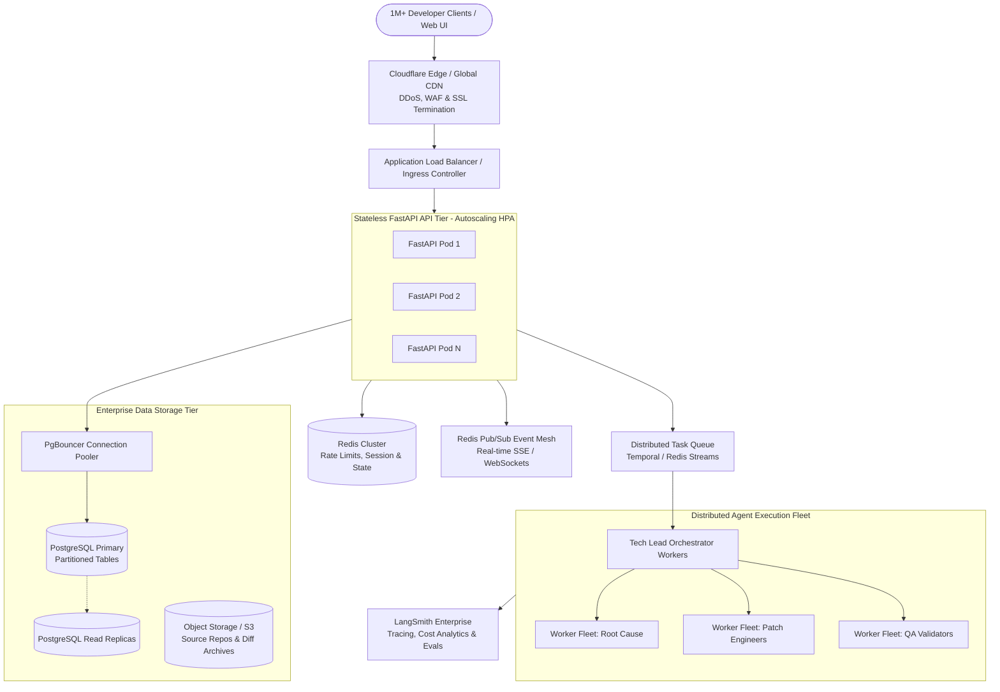

# High-Scale System Design: Scaling SwarmLead to Millions of Users

> **Version:** 1.0.0  
> **Status:** Canonical Architecture Specification  
> **Target Scale:** 1,000,000+ Users • 100,000 Daily Problem Swarms • 500,000 Concurrent Agent Steps  

---

## 1. System Vision & Architecture Evolution

SwarmLead FDE is designed with a seamless migration path from local high-performance development (SQLite + in-process LangGraph) to a globally distributed, cloud-native enterprise system:

---

## 2. Core Architectural Pillars

### Pillar 1: Asynchronous Distributed Task Orchestration
- **Problem at Scale:** Running 5 concurrent LLM agents across 10,000 problems synchronously would exhaust HTTP server worker threads in seconds.
- **Solution:** Decouple HTTP ingestion from agent swarm execution:
  1. API server accepts the problem, records `PENDING` in PostgreSQL, and enqueues a `SwarmExecutionJob` into **Temporal** (or **Redis Streams / Celery**).
  2. The client receives an immediate `202 Accepted` response with an SSE streaming ticket.
  3. Distributed worker pools pick up tasks based on agent specialization (e.g., QA workers run in sandboxed Docker containers to execute unit tests safely).

### Pillar 2: Database Partitioning & Connection Pooling
- **Storage Strategy:**
  - Transition from development SQLite to **PostgreSQL 16+**.
  - Partition high-volume tables (`agent_runs`, `agent_logs`) by month (`created_at`) and hash-partitioned by `tenant_id`.
  - Use **PgBouncer** in transaction pooling mode to support 50,000+ client connections without database memory exhaustion.
  - Large source code files and voluminous diffs are offloaded to **S3 / Cloudflare R2** with signed URLs, storing only metadata pointers in the relational database.

### Pillar 3: Real-Time Event Streaming Mesh
- **Challenge:** Millions of concurrent users watching live agent thought streams and Tech Lead interventions.
- **Solution:**
  - Stateless API nodes do not hold persistent in-memory queues.
  - Agent event logs publish to a **Redis Pub/Sub** channel keyed by `problem:{id}:events`.
  - Edge streaming servers subscribe to Redis channels and fan out Server-Sent Events (SSE) or WebSockets to connected browser clients with sub-50ms latency.

### Pillar 4: Multi-Provider LLM Circuit Breakers & Fallback
- **High-Availability Invariant:** Never fail a problem resolution due to an upstream OpenAI or Gemini outage:
  - Implement a **Circuit Breaker** (Netflix Hystrix pattern):
    - Primary: `gpt-4o`
    - Secondary: `gemini-1.5-pro`
    - Tertiary: `claude-3-5-sonnet`
    - Local / Air-gapped fallback: Self-hosted vLLM / Ollama instance.
  - Automatic exponential backoff with jitter on rate limits (HTTP 429).

### Pillar 5: Multi-Tenant Isolation & Quota Management
- **Enterprise Controls:**
  - Strict tenant isolation using PostgreSQL Row-Level Security (RLS) or dedicated tenant schemas.
  - Configurable hard limits per user/organization:
    - Maximum monthly spend budget (USD $).
    - Maximum concurrent swarm agents per problem (1–5).
    - Maximum daily tokens.
  - Sliding-window rate limiters enforced at the API gateway layer via Redis.

---

## 3. LangGraph Checkpointing & State Recovery

To survive server crashes or pod rescheduling mid-resolution:
- Use **LangGraph Postgres Checkpointer** (`AsyncPostgresSaver`).
- After every node execution (`tech_lead_decompose` $\rightarrow$ `worker_swarm` $\rightarrow$ `tech_lead_review`), the entire state graph is atomically checkpointed.
- If a worker node fails, the job resumes from the exact last checkpoint without re-running previous expensive agent steps, saving money and time.

---

## 4. Scalability Metrics & Capacity Target

| Metric | Development Benchmark | Production Target (1M Users) |
|---|---|---|
| Concurrent Users | 10 | 100,000 |
| Active Agent Swarms | 5 concurrent | 25,000 concurrent |
| Event Stream Latency | < 50ms | < 80ms globally |
| API Response Time (P95) | < 15ms | < 45ms |
| Data Tier Redundancy | Local file backup | Multi-AZ Cross-Region Read Replicas |
| System Availability SLA | 99.0% | 99.99% |
